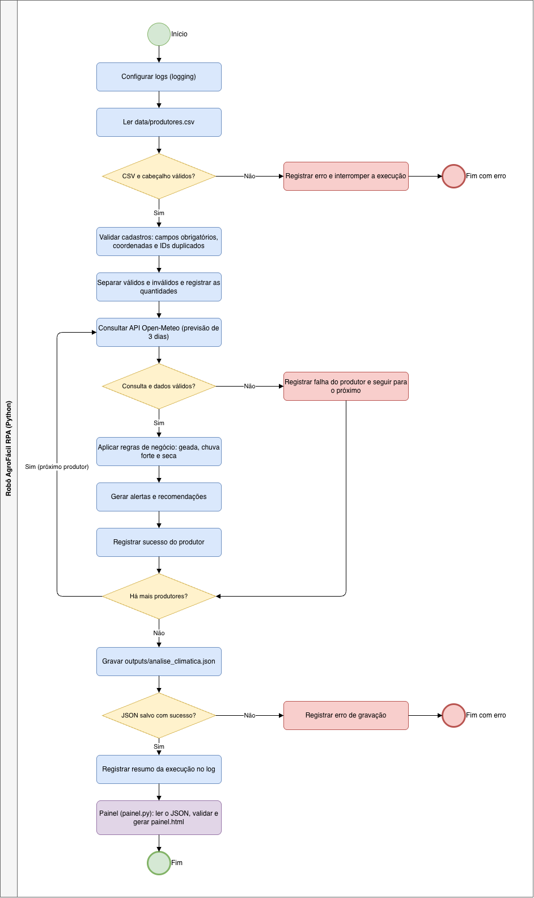

# AgroFácil RPA

## Sobre o projeto

O AgroFácil é uma solução desenvolvida para auxiliar pequenos produtores rurais no acompanhamento das condições climáticas e na tomada de decisões relacionadas ao cuidado com suas plantações.

O projeto utiliza automação em Python para consultar previsões meteorológicas, analisar condições climáticas e gerar alertas e recomendações de acordo com regras previamente definidas. Os resultados são consumidos por um painel web que apresenta as informações de forma organizada.

## Problema

Pequenos produtores podem ter dificuldades para acompanhar as mudanças climáticas e identificar situações que podem prejudicar suas plantações.

A falta de informações organizadas pode dificultar decisões relacionadas à irrigação, proteção contra geadas e monitoramento de chuvas intensas.

## Objetivo

Automatizar a consulta e a análise de dados meteorológicos, oferecendo informações que auxiliem o produtor no acompanhamento de sua plantação.

## Funcionalidades

- Leitura automática do cadastro de produtores por arquivo CSV.
- Validação dos dados cadastrais e das coordenadas geográficas.
- Consulta à previsão meteorológica por meio da API Open-Meteo.
- Análise das condições climáticas para os próximos três dias.
- Identificação de possíveis riscos de geada, seca e chuva forte.
- Geração de alertas e recomendações.
- Registro de logs para auditoria e acompanhamento da execução.
- Exportação dos resultados em arquivo JSON.
- Painel web que consome o JSON e exibe alertas, recomendações e previsão por produtor.
- Tratamento de erros, como falhas na API, cadastros inválidos e arquivo JSON ausente ou corrompido.

## Tecnologias utilizadas

- Python
- API Open-Meteo
- Biblioteca Requests
- CSV
- JSON
- Logging
- Unittest
- HTML e CSS (painel)

## Como funciona

1. O sistema realiza a leitura do arquivo de produtores.
2. Os dados são validados, identificando possíveis inconsistências.
3. Para cada produtor válido, o sistema consulta a API meteorológica utilizando latitude e longitude.
4. As informações climáticas são analisadas conforme as regras de negócio.
5. O sistema gera alertas e recomendações.
6. Os resultados são armazenados em um arquivo JSON.
7. A execução é registrada em arquivo de log.
8. O painel (`src/painel.py`) lê o JSON, valida o formato e gera uma página web com os resultados.

## Fluxo do processo (BPMN)



## Regras de negócio

O protótipo considera as seguintes condições:

- **Risco de geada:** temperatura mínima prevista menor ou igual a 2 °C.
- **Chuva forte:** precipitação diária maior ou igual a 20 mm.
- **Possível risco de seca:** precipitação acumulada inferior a 5 mm e temperatura máxima igual ou superior a 30 °C.
- **Baixa previsão de chuva:** precipitação acumulada inferior a 5 mm.

As regras são ilustrativas e devem ser validadas por especialistas, considerando a cultura agrícola, o solo e as condições locais antes de qualquer aplicação real.

## Estrutura do projeto

```text
agrofacil-rpa/
├── src/
│   ├── __init__.py
│   ├── main.py
│   ├── clima.py
│   ├── regras.py
│   ├── processador.py
│   ├── painel.py
│   └── logger_config.py
├── tests/
│   ├── test_clima.py
│   ├── test_regras.py
│   └── test_processador.py
├── data/
│   └── produtores.csv
├── logs/
│   └── agrofacil.log
├── outputs/
│   ├── analise_climatica.json
│   └── painel.html
├── assets/
│   ├── fluxo_bpmn.png
│   └── painel.png
├── docs/
│   ├── fluxo_bpmn.md
│   ├── PDD.md
│   └── relatorio_final.md
├── .gitignore
├── requirements.txt
└── README.md
```

## Como executar o projeto

### 1. Clonar o repositório

```bash
git clone https://github.com/leehbatista/agrofacil-rpa.git
cd agrofacil-rpa
```

### 2. Criar e ativar o ambiente virtual

```bash
python3 -m venv .venv
source .venv/bin/activate
```

### 3. Instalar as dependências

```bash
pip install -r requirements.txt
```

### 4. Executar a automação

```bash
python3 -m src.main
```

Gera o arquivo `outputs/analise_climatica.json` e o log `logs/agrofacil.log`.

### 5. Gerar e abrir o painel

```bash
python3 -m src.painel
```

Lê o arquivo `outputs/analise_climatica.json`, gera `outputs/painel.html` e abre o painel no navegador. Execute o passo 4 antes, para que o JSON exista.

### 6. Executar os testes

```bash
python3 -m unittest discover -s tests -v
```

## Testes

O projeto possui testes automatizados utilizando a biblioteca Unittest.

São testados:

- Consulta meteorológica bem-sucedida.
- Timeout e falha de conexão com a API.
- Resposta incompleta ou inconsistente da API.
- Validação de produtores.
- Identificação de coordenadas inválidas.
- Identificação de IDs duplicados.
- Identificação de campos obrigatórios vazios.
- Arquivo de cadastro inexistente.
- Regras de análise climática.
- Tratamento de previsão vazia.

**Resultado atual: 16 testes aprovados.**

## Integração com o MVP e arquivos gerados

O AgroFácil utiliza a API Open-Meteo para obter dados meteorológicos.

Os resultados das análises são exportados em formato JSON (`outputs/analise_climatica.json`) e **consumidos pelo componente `src/painel.py`**, que gera o painel web `outputs/painel.html` com os alertas e as recomendações de cada produtor. Os registros de execução e erros são armazenados em `logs/agrofacil.log`.


## Segurança e dados

O projeto utiliza dados fictícios de produtores para fins acadêmicos e de demonstração. As informações são processadas localmente, sem envio a serviços externos além da consulta de previsão por coordenadas, e não incluem dados pessoais sensíveis. Os logs registram apenas o ID dos produtores.

## Demonstração

<<<<<<< HEAD
Vídeo: https://youtu.be/Zpi-7k2LBhU?si=tvBxFnr0IyQq80q_
=======
Vídeo: https://youtu.be/Zpi-7k2LBhU?si=c25kO4Xyzd3bhXse
>>>>>>> ab06f5d (Projeto Final)

## Projeto acadêmico

Desenvolvido como parte da Global Solution 2026.2 — CitizenTech | FIAP

**Integrantes:**

- Leticia Fontana Baptista – RM550289
- Julia Palomari – RM551910
- Vinicius Sobreira Borges – RM97767
- Julia Ortiz – RM550204
>>>>>>> 79ccf6c (gs)
