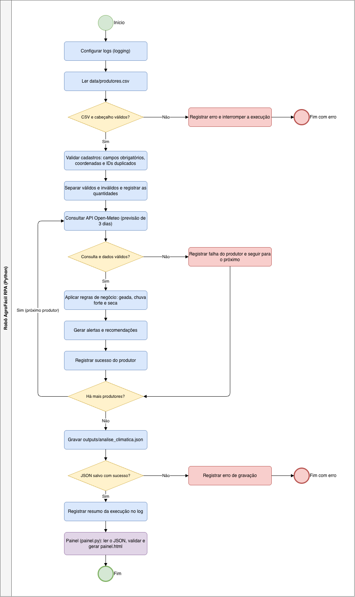
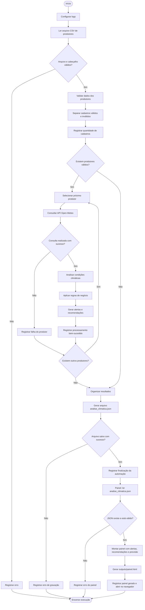

# Fluxo do Processo — AgroFácil RPA

## Representação do processo automatizado

O fluxo completo está no diagrama BPMN abaixo (`assets/fluxo_bpmn.png`):

A versão em texto do mesmo processo, em Mermaid, inclui a etapa final em que o painel consome o JSON gerado pela automação:

## Descrição do fluxo

O processo começa com a configuração dos logs e a leitura do cadastro de produtores.

Após a validação dos dados, o sistema separa os cadastros válidos dos inválidos e percorre os produtores válidos para consultar a previsão meteorológica.

Quando a consulta é bem-sucedida, as regras climáticas são aplicadas e os resultados são registrados. Quando ocorre uma falha, o erro é armazenado e o sistema continua com os próximos produtores.

Ao final, os resultados são organizados e exportados para o arquivo `outputs/analise_climatica.json`.

Em seguida, o componente `src/painel.py` consome esse arquivo: ele verifica se o JSON existe e está no formato esperado, monta uma página com os alertas, as recomendações e a previsão de cada produtor e gera o arquivo `outputs/painel.html`. Se o JSON estiver ausente ou corrompido, o erro é registrado em log e a geração do painel é interrompida.

## Componentes envolvidos

| Etapa | Componente | Entrada | Saída |
|---|---|---|---|
| Leitura e validação | `src/processador.py` | `data/produtores.csv` | Cadastros válidos e inválidos |
| Consulta climática | `src/clima.py` | Latitude e longitude | Temperatura atual e previsão de 3 dias |
| Regras de negócio | `src/regras.py` | Dados climáticos | Alertas e recomendações |
| Coordenação e saída | `src/main.py` | Resultados por produtor | `outputs/analise_climatica.json` |
| Consumo dos resultados | `src/painel.py` | `outputs/analise_climatica.json` | `outputs/painel.html` |
| Auditoria | `src/logger_config.py` | Eventos da execução | `logs/agrofacil.log` |