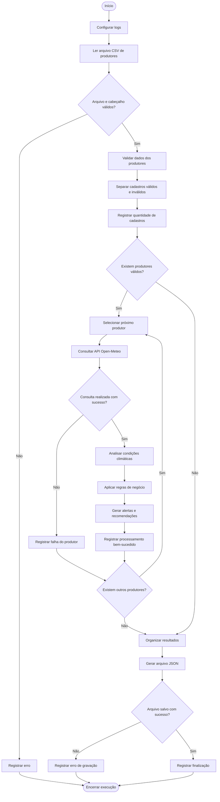

# Fluxo do Processo — AgroFácil RPA

## Representação do processo automatizado

## Descrição do fluxo

O processo começa com a configuração dos logs e a leitura do cadastro de produtores.

Após a validação dos dados, o sistema separa os cadastros válidos dos inválidos e percorre os produtores válidos para consultar a previsão meteorológica.

Quando a consulta é bem-sucedida, as regras climáticas são aplicadas e os resultados são registrados. Quando ocorre uma falha, o erro é armazenado e o sistema continua com os próximos produtores.

Ao final, os resultados são organizados e exportados para um arquivo JSON.
